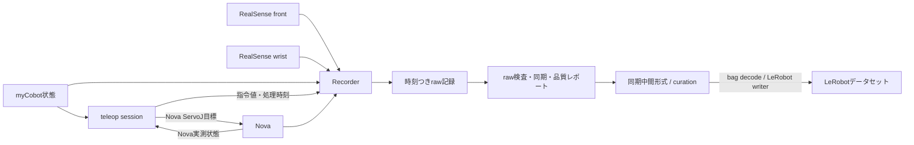

# 模倣学習データ収集の設計

## 目的

myCobotをリーダー、Dobot Nova5をフォロワーとして行うテレオペレーションを、カメラ映像とロボットの状態・指令を含む模倣学習用データとして記録する。収集時の元データを保持し、学習時にはLeRobot形式へ変換できるようにする。

この文書は実装方針と現在の実装状態を記録する。raw収録、オフライン検査、同期中間データ、LeRobot変換コードを実装した。LeRobot writer/readerの実データ確認、収録環境でのPython binding導入、目視同期確認は引き続き必要である。

## 設計方針

- ロボット制御、カメラ取得、データ記録、データセット変換を別モジュールに分ける。
- 制御ループでファイル書き込みや映像エンコードを行わない。記録用キューへデータを渡し、別スレッドで保存する。
- ロボットとカメラの取得時刻・時刻ドメインを保持したrawデータを先に保存する。
- rawデータから学習用の周期へ整列し、LeRobot形式に変換する。
- データ本体はGit管理せず、コード、設定例、スキーマ説明を管理する。

## 確認済みの初期ハードウェア

- 収録PCは現在のMacBook。
- RealSense D435iを2台接続している。
- 2台は同じUSB 3.1ハブ配下に接続されている。
- RealSense Viewerで両方のRGBストリームを確認済み。表示fpsは約29.7〜29.9。
- macOSでは `sudo rs-enumerate-devices` でSDKから2台を認識できることを確認した。

このfps表示だけではフレーム落ちや時刻ジッターの有無までは確定しない。記録実装ではフレーム番号と各フレームのタイムスタンプ差分を保存し、連続収録時に確認する。RealSense操作時に管理者権限が必要な点も実装・運用上の確認事項とする。

## ディレクトリ構成と実装状況

```text
mycobot-leader/
├── main.py                         # CLI入口: sync / teleop / record / inspect / quality / synchronize / export / curate
├── src/
│   └── mycobot_leader/
│       ├── cameras/
│       │   └── realsense.py        # RealSense bagとフレーム時刻sidecar
│       ├── recording/
│       │   └── recorder.py         # 非同期JSONL記録、session/episode metadata
│       └── datasets/
│           ├── raw_inspect.py      # rawの読取専用検査
│           ├── synchronize.py      # 時刻整列と中間データ出力
│           ├── quality_report.py  # タイミング・軌道・カメラ品質集計
│           ├── curation.py        # raw外に判断履歴を追記
│           └── lerobot_export.py  # LeRobot v3変換とreader往復確認
├── data/                           # ローカル記録。Git管理対象外
│   ├── recordings/
│   │   ├── <session-id>/
│   │       ├── session.json
│   │       └── episodes/
│   │           └── episode-0001/
│   │               ├── episode.json
│   │               ├── telemetry.jsonl
│   │               └── cameras/
│   │                   ├── front.bag
│   │                   ├── front.timestamps.jsonl
│   │                   ├── wrist.bag
│   │                   └── wrist.timestamps.jsonl
│   └── datasets/
│       └── synchronized/<version>/ # フレーム参照付き同期中間データ
│           ├── manifest.json
│           └── episodes/<episode>/
│               ├── samples.jsonl
│               ├── excluded.jsonl
│               └── diagnostics.json
└── ...
```

上記のraw収録・検査・同期中間データは現在の実装に合わせたもの。LeRobot変換コードは実装済みだが、Python binding導入と実データでのwriter/readback実行が必要。既存のフラットなロボット制御スクリプトは一括移動せず、`main.py`から呼び出す。

## データフロー



Recorderはデータを受け取ってキューに渡す。保存処理や映像エンコードは制御ループと分離する。キューが詰まったときに制御ループを長時間ブロックしないよう、キュー長、記録遅延、フレーム落ち数を計測・記録する。

## 記録データ

### ロボットの時系列

状態と指令はイベント種別ごとに可変レートで記録する。`telemetry.jsonl` の共通フィールドは `schema_version`、`episode_id`、`event_index`、`event_type`。状態イベントは `source` (`mycobot` / `nova`)、`joint_position_deg`、RPCの `host_request_start_ns` / `host_response_ns` を持つ。指令イベントは `action_name`、`action_semantics`、`joint_target_deg`、送信・応答時刻、ServoJ設定を持つ。現在のロボットSDKからデバイス取得時刻が得られない状態では `sensor_timestamp_ns: null` とし、PC側RPC区間を代わりに記録する。イベントは後処理で時刻整列する。

現在のrobot stateイベント例：

```json
{
  "schema_version": 1,
  "episode_id": "1",
  "event_index": 120,
  "event_type": "robot_state",
  "source": "mycobot",
  "sensor_timestamp_ns": null,
  "clock_domain": "unavailable; host RPC interval recorded",
  "host_request_start_ns": 1234567890123,
  "host_response_ns": 1234567891123,
  "joint_position_deg": [0, 0, 0, 0, 0, 0],
  "teleop_cycle": 120
}
```

actionイベントは別行に `event_type: "action"`、`action_name: "nova_servoj_joint_position"`、絶対目標角 `joint_target_deg`、`host_send_start_ns` / `host_response_ns` とServoJ設定を記録する。Nova状態は既存ポーリング頻度（約4 Hz）、myCobot状態とactionはテレオペの各周期で記録する。センサーが返す時刻はまだ取得できていないため、ホストRPC区間を保持し、センサー時刻と誤認しない。

角度は度で記録する。myCobotの観測状態、Novaの観測状態、Novaに送った行動を別イベントとして保持する。myCobot状態は人の操作入力を用いる学習や後分析にも利用できるので、Novaへの指令で置き換えない。

### カメラ

映像はカメラごとにRealSense SDKのnative `.bag` に記録し、対応する `<camera>.timestamps.jsonl` に各RGBフレームの番号、SDK時刻 (ms)、時刻ドメイン、frameset受信直後のPC単調時刻 (ns) を記録する。sidecarは終了時にflush/fsyncする。現在はRGB8のみで、深度ストリームは有効にしていない。カメラstampが露光開始・露光終了・転送時刻のどれを意味するかは機種・ドライバ仕様を確認する。

複数カメラのハードウェア同期は必須条件にしない。まず実際のタイムスタンプを記録して同期精度とフレーム落ちを測り、同時撮影が必要なタスクで精度が不足する場合にハードウェア同期を検討する。

## セッションとエピソード

- 1エピソードを1回のタスク試行とする。
- エピソードの開始・終了を明示する。
- タスクの自然言語説明、エピソード番号、開始・終了時刻、結果（成功・失敗・中断）、終了理由をメタデータに記録する。
- 機材または記録系の異常がない失敗試行は保存し、学習時に選別できるようにする。
- 通信断、記録破損、重大な同期異常などがある場合は理由を残し、正常な試行と区別する。

`session.json`には機材・設定・ソフトウェア情報などセッション全体に関わる情報を置く。`episode.json`にはタスク、結果、開始・終了情報など試行ごとの情報を置く。

## 学習用データへの変換

現在の `synchronize` / `export --format synchronized` コマンドは、参照カメラの受信単調時刻ごとに状態・行動・他カメラを照合し、除外理由を含むJSONL中間形式を出力する。`export --format lerobot` はこの対応結果を使ってbagからRGBを読み出し、LeRobot v3へ保存する。変換処理はテレオペレーションの制御経路から独立させる。カメラの実フレーム時刻を同期の基準候補とし、各時刻に最も近い指令を対応付ける。関節角などの連続値は、隣接する有効サンプル間に限り補間する。画像は補間せず実フレームを選ぶ。時刻範囲外のサンプルや、許容差を超えた組は無理に埋めず、除外として記録する。LeRobotのnominal FPS clockと取得時刻の差は、補助feature `source_time_ns` およびmatch delta featureに保持する。LeRobot v3のframe-based writerはfpsに基づく時刻を付けるため、この補助時刻を失わない。

観測時刻 `t` にどの指令をactionとするか（同時刻の指令か、遅延を考慮した `t + Δ` の指令か）はデータの意味を決める設計値である。rawには観測と指令の実時刻を両方保存し、Δを変えて変換・評価できるようにする。タイムスタンプの意味やロボット追従遅延は信号の相互相関などでも確認する。同期許容幅は固定の思い込みで決めず、複数の候補幅で採用率と同期ずれを測り、対象タスクで妥当な値を決める。

初期の目安は、現行制御周期に近い約30 Hzのロボット時系列と、640×480・30 fpsのRGB映像とする。これは測定後に調整する初期値であり、固定仕様ではない。深度画像はRGBでタスクに必要な視覚情報が得られない場合に追加する。

データセットのschemaとメタデータには、actionの意味を必ず記述する。少なくとも関節順、単位、ゼロ点・符号対応、絶対目標値か相対値か、制御周期、NovaのServoJ設定、観測とactionの時間差Δ、カメラ名・解像度・fps、座標系を含める。正規化を行う場合は、変換前の単位と正規化統計も保存する。

LeRobotのデータセットAPIはfpsに基づく時系列と動画フレームを扱う。そのため、変換後データに加え、取得時刻を含むraw記録を保持し、ずれや欠落の診断に使えるようにする。

## 初期実装の順序

1. [実装済み] 制御ループからmyCobot状態・Nova実測状態・Nova指令をホスト単調時刻区間つきJSONLに記録する。
2. [実装済み] セッションとエピソード、タスク名、結果をJSON metadataに記録する。
3. [実装済み] RealSense RGB映像をカメラ別bagに記録し、各フレームの時刻sidecarと基本的なフレーム落ち統計を保存する。
4. [実装済み] rawのread-only検査、タイミング・軌道・カメラ品質レポート、外部JSONLへのepisode単位keep / filter / relabel判断記録を用意する。
5. [実装済み] 参照カメラ時刻に状態・指令・他カメラを対応付ける中間JSONLと除外理由・manifestを出力する。
6. [実装済み・runtime確認待ち] bagからRGBフレームをデコードし、LeRobot writerでデータセットを作成してreaderで往復確認する。
7. [未実装] 変換後データを同期スクラブし、映像・観測・actionの対応を目視確認する。

## 品質検証とキュレーション

変換後データは学習に使う前に、少なくとも次の自動検査と目視確認を行う。

- タイムスタンプの単調性、重複、巻き戻り、Δt分布、フレーム落ち、各信号の実効Hzを検査する。
- エピソード長、関節・行動の範囲、スパイクや停滞区間、タスクごとの試行数を集計する。
- 映像と状態・actionを同じ時間軸で同期スクラブし、動作と指令の対応を確認する。
- 数百件以下の初期データは可能な範囲で全episodeを目視し、件数が増えたら統計的スクリーニングとサンプリング検品を組み合わせる。
- 安全に実施できる範囲で保存したaction列を再生し、関節順・単位・絶対/相対の解釈・再生速度を確認する。
- データ分割はフレーム単位ではなくepisode単位を最低限とし、汎化を評価するときは目的に応じてオペレータ、収集日、物体個体、環境単位で分ける。

判断は `keep`（採用）、`filter`（修復不能な破損の除外）、`relabel`（軌道は有効だがタスク等のラベルに誤りがある場合）として記録する。元rawを変更せず、除外episode ID、理由、処理方法を履歴に残す。失敗や動作品質の低さだけを理由に自動で捨てるとデータ分布を偏らせる可能性があるため、除外の影響は評価と合わせて判断する。

## データ系譜と再現性

raw記録は不変の取得記録として保存し、補正・同期・除外をrawへ上書きしない。変換ごとに新しいdataset versionを作り、manifestへ入力セッション/episode、スキーマ版、変換コードのGit commit、設定、時刻オフセット、同期許容幅、除外リスト、出力checksumを記録する。同じrawと同じ変換設定から同じデータセットを再生成できることを目標にする。

## 未決事項

- 利用するRealSenseの機種、台数、接続方式と、ハードウェア同期の要否。
- カメラの実際の取得fps・解像度と、PCのUSB帯域・エンコード性能。
- raw映像のコーデックと保存容量。
- 学習用に採用するLeRobotのバージョンと出力バージョン。
- 時系列の整列方法、許容する観測・指令・映像間の時間差。
- カメラ構成、タスク定義、成功・失敗のラベル付け方法。
- 観測時刻とactionの対応に採用するΔと、その妥当性を測る小規模な模倣学習・実機評価方法。

## データ管理

`data/recordings/`と`data/datasets/`はローカルデータ置き場とし、Gitには追加しない。`.gitignore`に`data/`が含まれていることを確認する。スキーマの変更時は、記録データのバージョンをメタデータに含め、過去データを読み分けられるようにする。

## 参考資料

- `artifacts/第6回 講義資料.pdf`（pp. 22–39, 55–60, 64–70）。非同期時刻、同期・補間、action定義、データ系譜、キュレーション、可視化・統計・リプレイの設計判断を反映。
